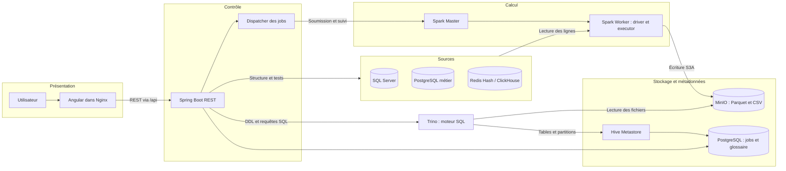
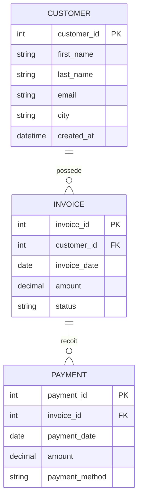
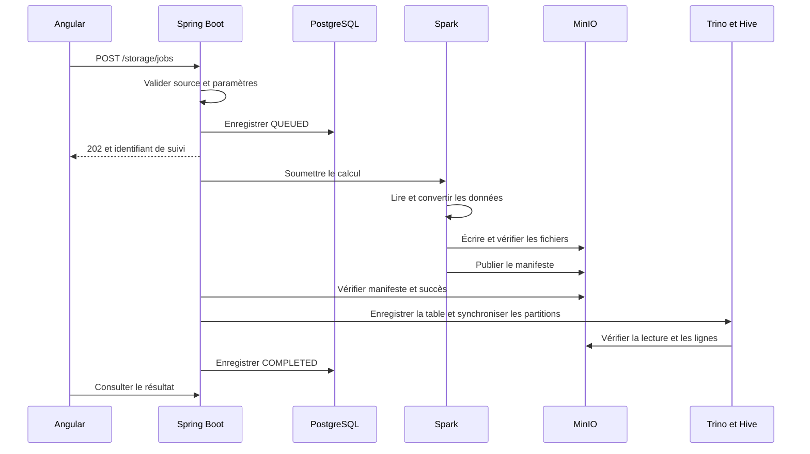
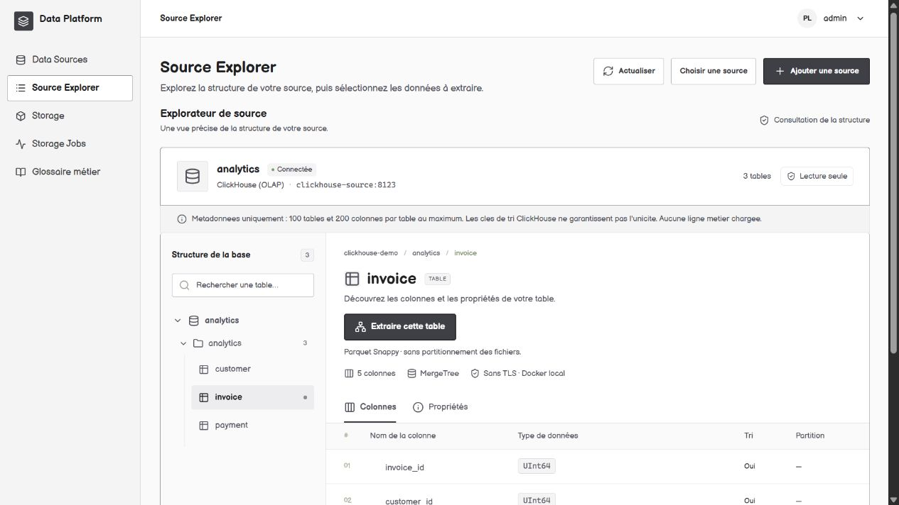

# Atlas — Plateforme de gestion distribuée des données

**Connecter des sources, explorer leur structure, extraire les données et les analyser en SQL dans un lac de données.**

Atlas est un projet universitaire développé avec **Angular et Java 21 / Spring Boot**,
exécuté localement avec **Docker Compose**. Le pipeline analytique associe
**Apache Spark, Parquet, MinIO, Hive Metastore et Trino**.

[Présentation complète pour le professeur](docs/presentation-professeur.md) ·
[Comparaisons de stockage](docs/comparaisons-stockage.md) ·
[Résultats mesurés](docs/benchmark-report.md) ·
[Organisation des branches](docs/organisation-branches.md)

> **Version de référence : `feature/atlas-platform`.** Elle regroupe le code validé
> jusqu'à l'explorateur commun et le support de présentation. `master` conserve
> le socle historique et n'a pas été fusionné automatiquement. Les travaux
> Spark multicœur, timestamps, retry et Iceberg restent séparés et non validés.
>
> **Une branche par fonctionnalité est conservée sur GitHub.** La branche de
> référence facilite la démonstration ; elle ne remplace pas les branches des
> fonctionnalités. Leur classement est décrit dans l'organisation des branches.
> Trois branches de documentation et de livraison ont été regroupées dans cette
> version de référence ; leurs tags historiques restent disponibles.

## 1. Présentation du projet

### Contexte et problématique

Une entreprise conserve ses clients, factures et paiements dans une base
relationnelle. Elle souhaite disposer d'un environnement analytique distinct,
organiser les extractions et comparer plusieurs stratégies de stockage.

**Comment rendre ces données accessibles pour des analyses SQL, dans une
architecture extensible séparant calcul, stockage et métadonnées ?**

Atlas couvre le parcours suivant :

```text
Source → Exploration → Extraction Spark → Parquet/CSV → MinIO
       → Enregistrement dans le catalogue → Trino → Analyses SQL
```

L'extraction sollicite la base source. Une fois le snapshot publié, les requêtes
`hive.*` lisent les fichiers MinIO sans retourner à SQL Server pour chaque analyse.

## 2. Objectifs et réponse au sujet

| Partie du sujet | Mise en œuvre |
|---|---|
| Connexion et exploration | Configuration, tests, tables, colonnes, types et relations |
| Sélection et extraction | Choix d'une table entière et lecture Spark/JDBC |
| Stockage | Parquet/CSV, compression et bucket MinIO |
| Organisation | Chemins par source, schéma, table et UUID de traitement |
| Partitionnement | Répertoires physiques et granularités temporelles |
| Accès SQL | Catalogue Hive, publication automatique et Trino |
| API REST | Création asynchrone, suivi et résultats persistants |
| Performance | Comparaisons de formats, partitions, compression et fetch sizes |
| Docker | Services et outils de construction conteneurisés |

La sélection fine des colonnes et les filtres de lignes restent à développer.
Le projet est extensible ; chaque nouveau moteur exige un connecteur et des tests.

## 3. Architecture globale cible



**Spring Boot contrôle les opérations ; Spark lit et produit les fichiers.**
Les lignes ne transitent pas toutes par le navigateur ou la mémoire de l'API.

| Couche | Responsabilité |
|---|---|
| Présentation | Connexion utilisateur, exploration, suivi et SQL |
| Control Plane | Validation, création, soumission et surveillance des jobs |
| Data Plane | Lecture, conversion et écriture des données |
| Metadata Plane | États, schémas, emplacements, partitions et glossaire |
| Analytics Layer | Planification et exécution des requêtes SQL |

La configuration validée utilise **un worker Spark, un cœur d'exécuteur par
application, un Trino mono-nœud et une instance MinIO**. Cette architecture locale
ne constitue pas une preuve de montée en charge sur plusieurs machines.

## 4. Technologies et rôle de chaque composant

| Technologie | Rôle | Pourquoi ce choix |
|---|---|---|
| Angular | Interface web | Formulaires, navigation et suivi des opérations |
| Spring Boot / Java 21 | API et orchestration | REST, validation, sécurité et organisation modulaire |
| JDBC | Accès relationnel | Contrat partagé et pilotes adaptés aux moteurs |
| Apache Spark | Ingestion | Calcul séparé du backend et production des fichiers |
| Parquet | Format analytique | Schéma typé, organisation colonnaire et compression |
| CSV | Format de comparaison | Évaluation d'une représentation textuelle |
| MinIO | Stockage objet local | API S3 accessible à Spark et Trino |
| Hive Metastore | Catalogue technique | Tables, types, emplacements et partitions |
| Trino | Analyse SQL | Requêtes sur le lac et fédération Redis optionnelle |
| PostgreSQL | Persistance technique | Jobs, glossaire et métadonnées du metastore |
| Docker Compose | Exécution locale | Construction et services sans SDK applicatifs hôtes |

PostgreSQL métier est une source dans un conteneur distinct du PostgreSQL de
métadonnées. Les composants analytiques principaux sont open source ; SQL Server
est la source propriétaire du cas pédagogique.

## 5. Modèle de données métier



Le jeu de démonstration contient **1 000 clients, 5 000 factures et 8 000 paiements**.
Une facture peut recevoir plusieurs paiements. Les montants utilisent des décimaux.
Le benchmark publié utilise une table séparée de **100 000 factures**.

Un générateur paramétrable existe. La génération d'un grand dataset et la mesure
du pipeline complet à grande échelle sont deux expérimentations différentes.

## 6. Partie 1 — Connexion et exploration

L'utilisateur choisit une source, teste son accès, explore sa structure et
sélectionne une table. La liste des sources ne déclenche pas de connexion
automatique à SQL Server.

| Source | Exploration | Extraction vers le lac |
|---|---|---|
| SQL Server | Tables, colonnes, types, PK/FK | Parquet/CSV, compression et partitions |
| PostgreSQL | Métadonnées JDBC | Même pipeline relationnel |
| ClickHouse | Tables, moteurs, colonnes et clés de tri/partition | Lecteur HTTP vers Spark ; sorties non partitionnées |
| Redis | Échantillon de clés, types et champs de hashes | Préfixe configuré, mapping explicite et déduplication des clés |
| MinIO | Objets et tailles | Consultation du stockage, sans ingestion générique de chaque fichier |

La SPI `RelationalPlugin`, découverte avec `ServiceLoader`, permet d'ajouter des
fournisseurs JDBC. Les connecteurs natifs ont une abstraction distincte.

Le nom de la base doit être fourni ; toutes les bases d'un serveur ne sont pas
énumérées. Une connexion ajoutée dans l'interface est temporaire pour l'exploration.
Les sources extractibles de la démonstration sont configurées côté serveur.

## 7. Partie 2 — Ingestion et suivi

### Exemple de demande

```json
{
  "source_id": "sqlserver",
  "table": "Invoice",
  "format": "parquet",
  "partition_by": ["invoice_date"]
}
```

L'API résout le schéma et les valeurs par défaut : Snappy, granularité mensuelle,
fetch size 1 000 et quatre partitions JDBC demandées si la clé est compatible.



Les états sont persistants : `QUEUED`, `SUBMITTING`, `RUNNING`, `REGISTERING`,
`COMPLETED` ou `FAILED`. `COMPLETED` exige des fichiers publiés et une table
interrogeable. Reprendre le suivi après redémarrage ne vaut pas relancer le calcul.

## 8. Partie 3 — Stockage, lots et partitions

```text
lake/sqlserver/dbo/Invoice/<UUID>/
├── manifest.json
└── data/
    ├── _SUCCESS
    └── invoice_date_year=2025/
        └── invoice_date_month=3/
            └── part-....parquet
```

Le manifeste conserve schéma, comptes, fichiers, octets, partitions, paramètres
et temps disponibles. Chaque extraction a un emplacement distinct.

| Réglage | Signification |
|---|---|
| `fetch_size` | Indication de récupération des lignes au pilote JDBC |
| `num_partitions` | Découpage logique des lectures Spark, si possible |
| `partition_by` | Organisation physique des fichiers par valeurs métier |

**Un lot n'est pas un fichier, et plusieurs partitions ne garantissent pas une
exécution simultanée.** Le buffering dépend du pilote ; la configuration actuelle
limite l'application à un cœur. La suggestion des partitions et les garde-fous de
cardinalité existent, mais ne constituent pas un optimiseur automatique.

## 9. Partie 4 — Catalogue et analyses SQL

Un fichier déposé dans MinIO ne devient pas automatiquement une table SQL.
Atlas crée la table externe, lui associe le chemin du run, synchronise les
partitions et contrôle son compte dans Trino.

Une table de run, telle que `hive.runs.invoice_<suffixe>`, représente un snapshot.
La vue courante Parquet `hive.sqlserver_dbo.invoice` pointe vers une seule
extraction ; elle ne concatène pas tous les répertoires historiques.
CSV dispose de tables de run, sans la même vue courante automatique.

### Exemple : facturation et paiements par ville

Après extraction et publication des trois tables :

```sql
WITH paiements AS (
  SELECT invoice_id, SUM(amount) AS montant_paye
  FROM hive.sqlserver_dbo.payment
  GROUP BY invoice_id
)
SELECT c.city,
       COUNT(*) AS nombre_factures,
       SUM(i.amount) AS montant_facture,
       SUM(COALESCE(p.montant_paye, 0)) AS montant_paye
FROM hive.sqlserver_dbo.customer c
JOIN hive.sqlserver_dbo.invoice i ON i.customer_id = c.customer_id
LEFT JOIN paiements p ON p.invoice_id = i.invoice_id
GROUP BY c.city
ORDER BY montant_facture DESC;
```

Les paiements sont agrégés avant la jointure pour ne pas multiplier le montant
d'une facture ayant plusieurs versements. Les requêtes `hive.*` lisent MinIO ;
le catalogue `redis.*` lit directement Redis dans un parcours fédéré distinct.

## 10. Partie 5 — Qualité et glossaire métier

Le profil de qualité compare comptes, montants, identifiants, références
orphelines et cohérences de dates entre source et lac. Un rapport conservé
contient **92 contrôles réussis**. Les agrégats ne sont pas un checksum intégral
ni un snapshot transactionnel commun aux systèmes.

Le glossaire explique le sens des données. Par exemple, **Montant facturé** peut
être associé à `sqlserver / dbo / Invoice / amount`. Les liens sont validés sur
la structure réelle et persistés dans PostgreSQL. L'interface permet recherche,
édition et navigation. Le glossaire ne génère pas automatiquement du SQL métier.

## 11. Partie 6 — API, sécurité et code

| Méthode | Endpoint | Rôle |
|---|---|---|
| GET | `/sources` | Sources relationnelles configurées |
| GET | `/sources/{id}/tables` | Tables accessibles |
| GET | `/connectors` | Plugins relationnels disponibles |
| GET | `/native/sources` | Profils natifs |
| POST | `/storage/jobs` | Créer une extraction asynchrone |
| GET | `/storage/jobs/{id}` | Suivre son état |
| GET | `/storage/jobs/{id}/result` | Lire son résultat publié |
| GET | `/storage/jobs/partition-candidates` | Aide au partitionnement |
| GET | `/catalog/tables` | Résultats enregistrés |
| POST | `/sql/query` | Analyse autorisée en lecture |
| POST | `/quality/reports` | Réconciliation métier |
| GET/POST | `/glossary/terms` | Rechercher ou créer des termes |

Nginx expose ces chemins au navigateur sous `/api`. Les réponses distinguent
notamment acceptation `202`, validation `422`, ressource absente `404`, résultat
indisponible `409` et indisponibilité de service `503`.

Le backend est organisé verticalement dans `features/<fonctionnalité>/`, avec
`api`, `service`, `dto`, `connector` et `config` selon les besoins. Les contrôleurs
délèguent aux services ; les erreurs transversales se trouvent dans `shared`.

La sécurité repose sur Spring Security, BCrypt, session HttpOnly, CSRF, comptes
lecteurs et séparation des droits Trino. Les secrets viennent de l'environnement
et `.env` reste privé. Un déploiement exposé demanderait TLS vérifié, autorisations
plus fines et gestion de secrets adaptée. La session applicative reste en mémoire.

## 12. Interface et démonstration

```text
Login → Data Sources → Source Explorer → Extraction → Storage Jobs → Console SQL
                              ↕
                         Glossaire métier
```

L'explorateur commun garde le même cadre pour les sources, en montrant les
colonnes relationnelles, les clés Redis ou les objets MinIO selon le moteur.



Pour la soutenance : présenter le besoin et l'architecture, explorer Invoice,
configurer une extraction, montrer un résultat COMPLETED, exécuter la jointure,
puis expliquer la qualité, le glossaire et les comparaisons de performance.

Préparer des UUID réussis et vérifier les services avant le passage. Ne pas lancer
une campagne volumineuse pendant la démonstration. Une réponse de soumission
incertaine impose de vérifier les jobs avant de relancer.

## 13. Performance et résultats

La campagne enregistrée porte sur **100 000 factures**, huit scénarios et trois
répétitions : **24 extractions et 216 requêtes SQL mesurées**, plus 72 warmups.

| Scénario | Taille en Mio | Fichiers | Lecture/conversion/écriture en s | SQL global en ms | SQL janvier en ms |
|---|---:|---:|---:|---:|---:|
| CSV brut | 5,290 | 2 | 19,121 | 159 | 580 |
| CSV gzip | 1,251 | 2 | 17,630 | 297 | 476 |
| Parquet brut | 1,793 | 2 | 18,103 | 165 | 144 |
| Parquet Snappy | 1,230 | 2 | 19,724 | 222 | 229 |
| Parquet Zstd | 0,690 | 2 | 18,607 | 138 | 197 |
| Parquet mensuel | 1,248 | 48 | 24,673 | 308 | 246 |
| Parquet, fetch 100 | 1,230 | 2 | 16,977 | 137 | 153 |
| Parquet, fetch 10 000 | 1,230 | 2 | 17,138 | 183 | 225 |

Zstd réduit ici le stockage de **86,96 %** par rapport au CSV brut. Le pruning
réduit les lignes traitées pour janvier de 100 000 à 4 247, sans gain de latence
sur ce petit dataset. Il utilise des prédicats explicites année/mois.

Le temps `extract_write_ms` combine lecture, conversion et transfert ; le temps
de catalogue n'est pas un temps d'upload isolé. Les caches ne sont pas purgés et
la campagne ne démontre pas une scalabilité multiworker. Voir le [rapport](docs/benchmark-report.md)
et l'[explication des quatre comparaisons](docs/comparaisons-stockage.md).

## 14. Exécution locale

Git, Docker Desktop en conteneurs Linux et PowerShell suffisent sur Windows.
Java, Maven et Node sont exécutés dans Docker. Vérifier RAM, disque et ports.

```powershell
git clone --branch feature/atlas-platform https://github.com/l8haitham-ctrl/distibuteddatam2.git atlas
cd atlas
powershell -NoProfile -File scripts/setup-env.ps1

$compose = @(
  '-f', 'docker-compose.yml',
  '-f', 'docker-compose.connectors.yml',
  '-f', 'docker-compose.analytics.yml',
  '-f', 'docker-compose.benchmarks.yml',
  '-f', 'docker-compose.soccer.yml',
  '-f', 'docker-compose.clickhouse.yml'
)
docker compose @compose up -d --build --wait --wait-timeout 300
docker compose @compose ps -a
```

Une ancienne configuration `.env` est conservée et peut demander des compléments.
Ne pas remplacer les secrets de bases déjà initialisées. Les fixtures benchmark
et Soccer ont des étapes explicites de préparation/import. Ne jamais supprimer
les volumes pour mettre à jour le projet.

| Interface | Adresse |
|---|---|
| Application | `http://localhost:3000` |
| Santé API | `http://localhost:8000/health` |
| Swagger | `http://localhost:8000/docs` — session nécessaire |
| MinIO | `http://localhost:9001` |
| Spark | `http://localhost:8088` |

Le dernier environnement complet reste à revalider depuis une installation
vierge. Les guides d'anciennes étapes peuvent décrire une version historique.

## 15. Cible cloud, limites et bonus

La séparation stockage/calcul et la configuration externe préparent une évolution
cloud : S3 sur AWS ou Blob/ADLS avec les adaptateurs nécessaires sur Azure,
PostgreSQL administré et plateforme de conteneurs adaptée. Aucun déploiement
AWS/Azure n'est revendiqué comme validé. Une URL Blob ne remplace pas directement
une URL S3.

| Fonctionnalité | État de référence |
|---|---|
| Connexion, exploration et choix explicite | Validés |
| Ingestion, partitions, catalogue et SQL sur le lac | Validés sur les données compatibles |
| SQL Server, PostgreSQL, Redis Hash et ClickHouse | Connecteurs validés avec limites propres |
| Glossaire, qualité et benchmark 100k | Implémentés avec preuves conservées |
| Statistiques de stockage | Bonus réalisé : lignes, fichiers, octets et partitions |
| Retry d'un job échoué | Préparé séparément, non validé/déployé |
| Iceberg | Intégration préparée séparément, aucune création réelle encore validée |
| Spark configurable et multiworker | Préparé ; parallélisme réel non démontré |
| Précision temporelle | Correction préparée, non validée |
| Projection de colonnes et filtres d'extraction | À développer |
| Incrémental, CDC et évolution de schéma formalisée | Non implémentés |
| Comparaison Iceberg/autres stratégies | Non réalisée |

La version CSV historiquement validée conserve les timestamps à la seconde ;
le catalogue utilise TIMESTAMP(3). Les chaînes CSV ont un contrat restrictif.
Les reprises après panne, l'idempotence initiale, les petits fichiers et le
nettoyage restent des points d'amélioration.

Iceberg est un **format de table autour des fichiers**. La cible proposée est
une matérialisation d'un snapshot Hive en table Iceberg v2, avec métadonnées et
snapshots distincts. Elle ne remplace pas automatiquement le pipeline existant
et ne prouve pas que tous les autres bonus sont réalisés.

## 16. Documentation et présentation

| Sujet | Support |
|---|---|
| Architecture détaillée, plan oral et questions du professeur | [Présentation](docs/presentation-professeur.md) |
| Les quatre comparaisons du sujet | [Explication des benchmarks](docs/comparaisons-stockage.md) |
| Protocole et résultats bruts | [Benchmarks](docs/benchmarks.md) · [Rapport](docs/benchmark-report.md) |
| API et ingestion | [Jobs](docs/storage-jobs.md) |
| Catalogue et SQL | [Hive/Trino](docs/catalog-trino.md) |
| Connecteurs | [Plugins](docs/connector-plugins.md) · [PostgreSQL](docs/postgresql-connector.md) |
| Sources natives | [ClickHouse](docs/clickhouse-extraction.md) · [Redis Hash](docs/redis-hash-extraction.md) |
| Glossaire | [Backend](docs/business-glossary.md) · [Interface](docs/business-glossary-ui.md) |
| Qualité | [Contrôles](docs/data-quality.md) |
| Installation | [Guide de livraison](docs/delivery.md) — tenir compte de sa version |
| Cloud | [Cible AWS/Azure](docs/architecture-cloud.md) |
| Organisation Git | [Branches et archives](docs/organisation-branches.md) |
| Ancien socle master | [Référence historique](docs/socle-historique.md) |

La documentation présente des capacités vérifiées et des limites explicites,
sans transformer des travaux préparés ou des possibilités des technologies en
fonctionnalités effectivement livrées.

## Skills du projet

Les consignes par fonctionnalité, le workflow de maintenance et les contrats API
sont accessibles dans [les skills Atlas](.agents/skills/README.md). Le contexte
indique les fonctionnalités et routes présentes dans cette branche.
