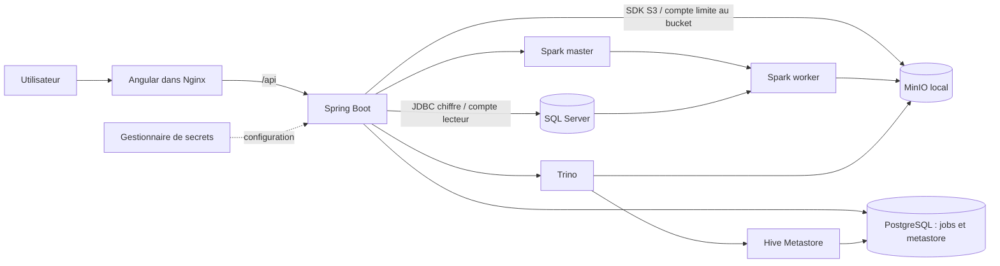
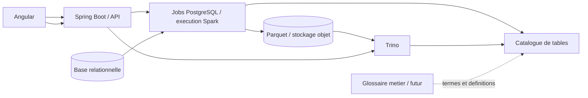

# Architecture Azure et AWS

## Etat actuel

Angular, Spring Boot, SQL Server de test, PostgreSQL, Spark, MinIO et les outils de compilation sont
conteneurises. L'API est sans etat, configurable par environnement et dispose
de sondes de sante et d'un arret gracieux. Les images de production de l'API
et du frontend ne tournent pas en root. Le navigateur utilise le meme domaine pour l'interface et `/api`.

Une premiere ingestion Spark/Parquet avec jobs persistants est disponible en
local, avec catalogue Hive et acces SQL Trino maintenant implementes et testes.
Les sources PostgreSQL et Redis/MinIO sont optionnelles. Ce document
decrit la cible ; il ne signifie pas qu'un environnement cloud est deploye.

## Application actuellement livree

## Cible analytique

Les liens du glossaire identifieront la source, le schema, la table et, si
necessaire, la colonne. Le catalogue technique et le glossaire metier auront
des roles distincts. Les metadonnees du glossaire ne seront pas ecrites dans
la base relationnelle source.

## Correspondance des services

| Besoin | Local | Azure | AWS |
| --- | --- | --- | --- |
| Orchestration de la cible complete | Docker Compose | AKS | EKS |
| Registre d'images | Docker local | Azure Container Registry | Amazon ECR |
| Source SQL Server | Conteneur de test | Azure SQL Managed Instance ou source existante | Amazon RDS for SQL Server ou source existante |
| Stockage objet | MinIO | Azure Blob Storage / ADLS Gen2 | Amazon S3 |
| Historique des jobs | PostgreSQL | Azure Database for PostgreSQL | Amazon RDS for PostgreSQL |
| Calcul d'ingestion | Spark standalone | Spark sur AKS ou service gere | Spark sur EKS ou service gere |
| Secrets | `.env` ignore par Git | Azure Key Vault | AWS Secrets Manager |
| Observabilite | Logs stdout et sondes | Azure Monitor | CloudWatch |
| Identite de service pour stockage futur | Configuration locale | Workload Identity | EKS Pod Identity / IAM |

AKS et EKS sont proposes pour garder une architecture portable et accueillir
Trino et ses workers. Pour le seul couple frontend/API, des services de
conteneurs plus simples peuvent suffire ; Kubernetes n'est pas indispensable
pour tester cette premiere version.

Trino devra utiliser le connecteur de stockage adapte : S3 pour AWS, Azure
pour Blob/ADLS. Une URL Azure Blob n'est pas un remplacement transparent
d'une URL S3 MinIO. Le catalogue doit rester accessible aux jobs et a Trino.

Le module actuel utilise une interface Java `ObjectStorage` et un adaptateur
MinIO/S3 configure par environnement. Il n'implemente pas encore Azure Blob,
les fournisseurs d'identite cloud ni la gestion automatique des jetons.
Le stockage reste desactive par defaut dans les modeles Kubernetes ; son
activation necessitera le bucket, l'endpoint et un secret externe adapte.
Le bootstrap MinIO avec compte root est exclusivement local, comme le
bootstrap SQL Server. Il ne fait pas partie d'un deploiement cloud.

Le Compose livre un master et un worker Spark pour valider le parcours. Les
modeles Kubernetes precedents n'activent ni `JOBS_ENABLED` ni le cluster Spark.
Le controle REST Spark local est prive au reseau Docker ; sa protection,
les identites de service et l'acces au stockage cloud restent a configurer
avant un deploiement multi-machines. Aucun cloud n'est deploye par cette branche.

## Preparation avant exposition en production

1. Construire les images, les scanner et les publier dans ACR ou ECR avec un
   tag immuable ou un digest. Ne pas embarquer de `.env` dans les images.
2. Remplacer la base de demonstration par une source privee et un compte de
   lecture cree par l'administrateur de cette source. Le bootstrap `sa` et les
   donnees fictives sont exclusivement destines au Compose local.
3. Alimenter le secret Kubernetes `atlas-source-credentials` depuis Key Vault
   ou Secrets Manager avec le mecanisme retenu. Le manifeste ne contient pas
   de mot de passe.
4. Terminer le TLS et l'authentification OIDC a l'entree et proteger l'API
   avant d'ajouter une entree publique. Cette version locale n'implemente pas
   encore l'authentification multiutilisateur.
5. Limiter les destinations accessibles au connecteur JDBC aux bases autorisees
   par les regles reseau du VNet/VPC. Ne pas exposer SQL Server sur Internet.
6. Verifier les certificats : `SOURCE_TRUST_SERVER_CERTIFICATE=false` en cloud.
7. Configurer logs, alertes, sauvegardes et rotation des identifiants.

Les fichiers `deploy/k8s/base` constituent une base de deploiement privee,
sans Ingress public ni creation d'infrastructure payante. Les noms d'images,
le serveur SQL et les secrets doivent etre renseignes avant utilisation.
Ils ne provisionnent ni AKS/EKS, ni reseau, ni gestionnaire de secrets.

Verification effectuee : syntaxe YAML, coherence des selecteurs et des ports,
presence des sondes, ressources et contraintes non root. Ces manifests n'ont
pas ete appliques a un cluster ni valides par une API Kubernetes.

## Sources de reference

- [Architecture AKS de reference](https://learn.microsoft.com/en-us/azure/architecture/reference-architectures/containers/aks/baseline-aks)
- [Securite reseau EKS](https://docs.aws.amazon.com/eks/latest/best-practices/network-security.html)
- [Azure SQL Managed Instance](https://learn.microsoft.com/en-us/azure/azure-sql/managed-instance/sql-managed-instance-paas-overview)
- [Amazon RDS for SQL Server](https://docs.aws.amazon.com/AmazonRDS/latest/UserGuide/CHAP_SQLServer.html)
- [TLS JDBC SQL Server](https://learn.microsoft.com/en-us/sql/connect/jdbc/configuring-the-client-for-ssl-encryption)
- [Stockage Azure dans Trino](https://trino.io/docs/current/object-storage/file-system-azure.html)
- [Stockage S3 dans Trino](https://trino.io/docs/current/object-storage/file-system-s3.html)
