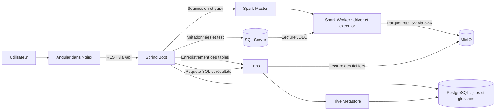
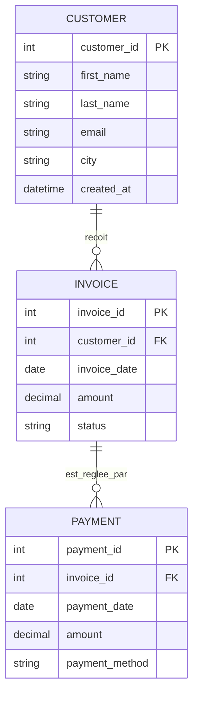
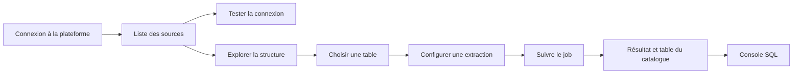
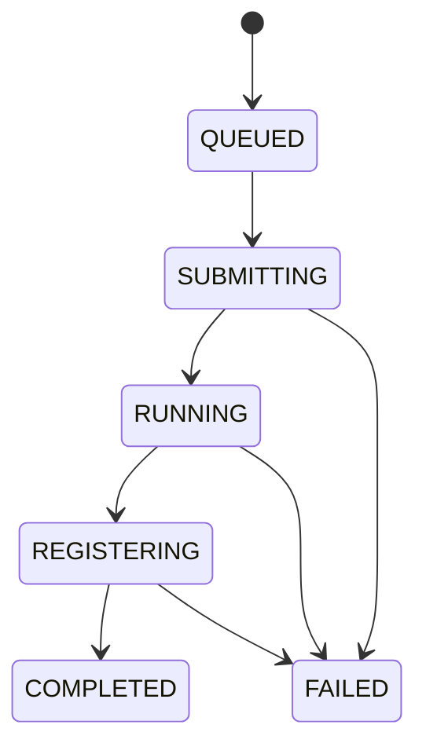
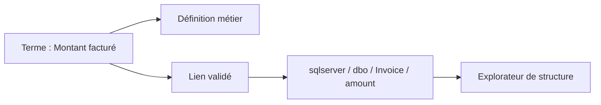
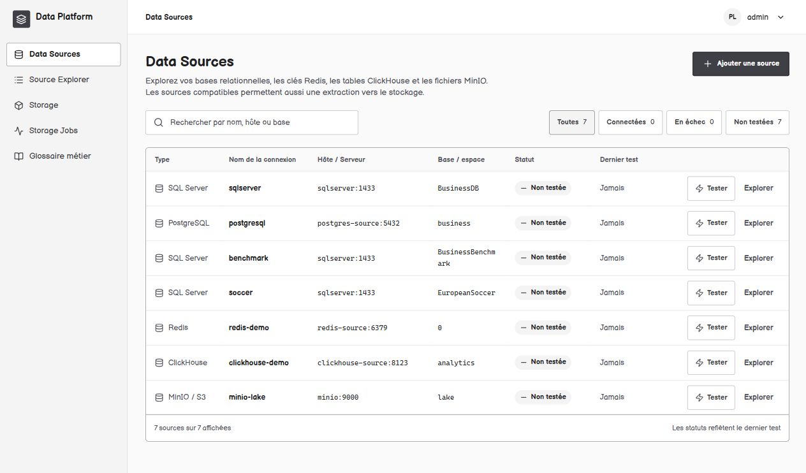
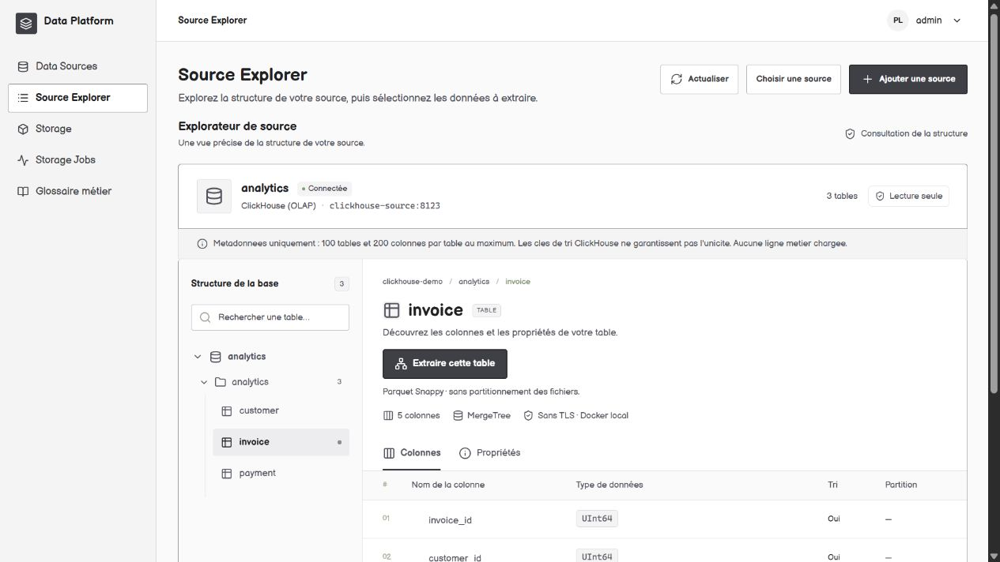
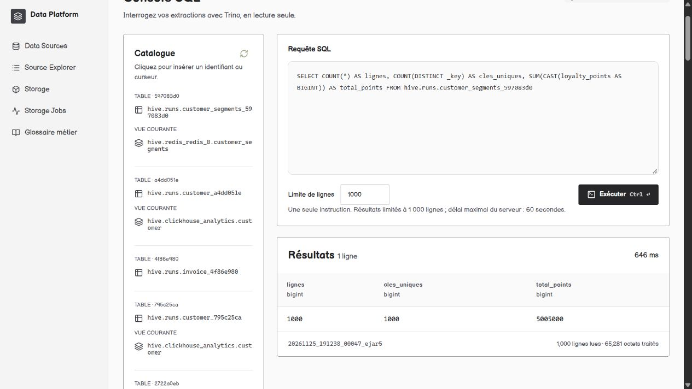

# Atlas — Présentation du projet et architecture globale

**Projet :** gestion distribuée des données et plateforme analytique extensible  
**Support de soutenance — version du 27 novembre 2026**  
**Équipe :** à compléter  
**Enseignant :** à compléter

> **Périmètre présenté.** Ce document décrit les fonctionnalités validées jusqu'à
> `feature/unified-source-explorer` (`6130492`). Les réglages Spark distribués et
> la correction de précision temporelle préparés ensuite restent non validés et
> ne sont pas annoncés comme livrés. Les mesures citées sont des résultats
> enregistrés, pas une nouvelle campagne exécutée pour cette présentation.

## Sommaire

1. [Présentation et problématique](#1-présentation-et-problématique)
2. [Objectifs et périmètre](#2-objectifs-et-périmètre)
3. [Architecture globale](#3-architecture-globale)
4. [Rôle des technologies](#4-rôle-des-technologies)
5. [Données et modèle métier](#5-données-et-modèle-métier)
6. [Parcours utilisateur](#6-parcours-utilisateur)
7. [Flux complet d'une extraction](#7-flux-complet-dune-extraction)
8. [Lots et partitionnement](#8-lots-et-partitionnement)
9. [Stockage et catalogue](#9-stockage-et-catalogue)
10. [Analyses SQL](#10-analyses-sql)
11. [Architecture du backend et API](#11-architecture-du-backend-et-api)
12. [Connecteurs et extensions](#12-connecteurs-et-extensions)
13. [Glossaire métier](#13-glossaire-métier)
14. [Sécurité et qualité](#14-sécurité-et-qualité)
15. [Docker et préparation cloud](#15-docker-et-préparation-cloud)
16. [Résultats de performance](#16-résultats-de-performance)
17. [Validation et conformité](#17-validation-et-conformité)
18. [Limites et perspectives](#18-limites-et-perspectives)
19. [Scénario de démonstration](#19-scénario-de-démonstration)
20. [Plan oral et questions](#20-plan-oral-et-questions)

## 1. Présentation et problématique

Une entreprise possède des informations sur ses clients, ses factures et ses
paiements dans une base relationnelle. Elle souhaite les analyser dans un
environnement distinct, avec un stockage adapté aux traitements analytiques.

**Atlas permet de connecter une source, comprendre sa structure, extraire ses
données, les stocker dans un lac de données et les interroger en SQL.**

L'application relie deux usages :

- **opérationnel** : les applications métier utilisent la base source ;
- **analytique** : des snapshots extraits servent aux agrégations et jointures.

Les analyses du lac peuvent ainsi être réalisées sur les fichiers extraits, sans
relire SQL Server pour chaque requête. L'extraction elle-même sollicite toutefois
la source : Atlas ne supprime pas son coût de lecture.

### Présentation courte à dire à l'oral

> « Atlas est une plateforme de données développée avec Angular et Spring Boot.
> Elle permet d'explorer des sources, de déclencher des extractions Spark et de
> produire des fichiers Parquet ou CSV dans MinIO. Les résultats sont enregistrés
> dans un catalogue Hive, puis interrogés avec Trino depuis une console SQL.
> Nous comparons également les formats, la compression, le partitionnement et
> les tailles de lots à partir de mesures réelles. »

## 2. Objectifs et périmètre

Le parcours principal suit le sujet du professeur :

```text
SQL Server → Service d'ingestion → Parquet → MinIO
           → Catalogue Hive → Trino → Requêtes SQL
```

| Objectif | Réponse apportée par Atlas |
|---|---|
| Se connecter et tester une base | Sources configurées, tests et diagnostic de connexion |
| Explorer la structure | Tables, colonnes, types, PK et FK pour le relationnel |
| Choisir les données | Sélection d'une table entière dans la version validée |
| Extraire sans tout charger dans l'API | Lecture réalisée par Spark, réglage JDBC `fetch_size` |
| Produire des fichiers analytiques | Parquet et CSV compatibles avec le contrat Hive |
| Stocker les fichiers | Bucket privé MinIO, chemins par source/schéma/table/job |
| Partitionner | Organisation physique par colonnes, dont année/mois/jour |
| Interroger en SQL | Catalogue Hive et moteur Trino intégrés |
| Suivre les traitements | États persistés dans PostgreSQL et interface de suivi |
| Comparer les stratégies | Campagne reproductible et résultats enregistrés |

Le socle fonctionne. La sélection fine de colonnes/lignes et la séparation des
temps de lecture, transformation et transfert restent à compléter ou clarifier.

## 3. Architecture globale

### 3.1 Vue d'ensemble



**À expliquer :** le backend pilote l'extraction, mais les lignes source passent
de la base à Spark, puis à MinIO. Elles ne transitent pas toutes par le navigateur
ou la mémoire de l'API.

### 3.2 Les cinq responsabilités

| Couche | Composants | Responsabilité |
|---|---|---|
| Présentation | Angular, Nginx | Interaction, exploration, suivi et SQL |
| Contrôle | API Spring Boot, dispatcher | Valider, créer, soumettre et suivre les jobs |
| Données | Sources, Spark, MinIO | Lire, convertir et stocker les lignes |
| Métadonnées | PostgreSQL, Hive Metastore | Conserver états, schémas, emplacements et partitions |
| Analyse | Trino | Exécuter les requêtes SQL sur les données du lac |

PostgreSQL existe aussi comme **source métier distincte**, dans un autre
conteneur. Ce rôle ne doit pas être confondu avec PostgreSQL de métadonnées.

## 4. Rôle des technologies

| Technologie | Pourquoi elle est utilisée | Limite à connaître |
|---|---|---|
| Angular | Interface structurée, formulaires et navigation | Certaines configurations restent côté serveur |
| Java 21 / Spring Boot | REST, validation, sécurité et orchestration | L'API n'est pas le moteur de calcul des extractions |
| JDBC | Contrat d'accès aux bases relationnelles | Chaque moteur exige un pilote et un plugin validés |
| Spark | Lecture et production des fichiers hors de l'API | Configuration locale limitée en parallélisme |
| Parquet | Stockage typé et colonnaire adapté à l'analyse | Ce n'est pas un format de table transactionnel |
| CSV | Format de comparaison et d'échange simple | Contrat de représentation plus restrictif dans Atlas |
| MinIO | Stockage objet compatible S3 en local | Une seule instance dans la démonstration |
| Hive Metastore | Catalogue des tables, colonnes et partitions | Il ne contient pas les lignes métier |
| Trino | SQL sur le lac et certaines sources fédérées | Mono-nœud dans la version validée |
| PostgreSQL | Persistance des états et des métadonnées | Ne remplace pas le stockage objet |
| Docker Compose | Construction et exécution locales | Ne constitue pas un déploiement cloud validé |

Les composants analytiques principaux sont open source. SQL Server est un moteur
propriétaire utilisé ici comme source du cas pédagogique. L'extensibilité est
illustrée aussi par une source PostgreSQL.

## 5. Données et modèle métier

### 5.1 Tables principales

| Table | Colonnes métier principales |
|---|---|
| Customer | customer_id, first_name, last_name, email, city, created_at |
| Invoice | invoice_id, customer_id, invoice_date, amount, status |
| Payment | payment_id, invoice_id, payment_date, amount, payment_method |

Des colonnes techniques peuvent compléter ce modèle, notamment `updated_at`.
Leur présence ne signifie pas qu'une ingestion incrémentale est implémentée.



Un client peut avoir plusieurs factures. Une facture peut être réglée par
plusieurs paiements. Cette dernière relation impose de préparer correctement
les jointures pour éviter de compter plusieurs fois le montant d'une facture.

### 5.2 Volumes utilisés

- Démonstration SQL Server : 1 000 clients, 5 000 factures et 8 000 paiements.
- Benchmark : table distincte de 100 000 factures synthétiques.
- Redis : 1 000 hashes de segmentation client dans le préfixe configuré.
- ClickHouse : démonstration indépendante avec clients, factures et paiements.
- Soccer : 222 796 lignes importées dans sept tables SQL Server depuis une archive Kaggle.

Le générateur relationnel est paramétrable. Les campagnes à un, cinq ou dix
millions de lignes ne sont pas présentées comme exécutées.

## 6. Parcours utilisateur



### Écrans à présenter

| Écran | Ce que l'utilisateur peut montrer |
|---|---|
| Login | Accès authentifié à la plateforme |
| Data Sources | Sources relationnelles et natives dans une liste commune |
| Source Explorer | Arborescence, recherche et détails adaptés au moteur |
| Assistant d'extraction | Format, compression, lots et partitions pour le relationnel |
| Storage Jobs | État, dates, résultat et informations de stockage |
| Console SQL | Requêtes sur les tables enregistrées et statistiques d'exécution |
| Glossaire métier | Définitions et associations aux tables/colonnes relationnelles |

La liste des sources ne connecte pas automatiquement SQL Server au démarrage.
L'utilisateur choisit explicitement une source.

**Nuance sur l'ajout de connexion :** le formulaire relationnel permet une
exploration temporaire. Le mot de passe n'est pas conservé dans le navigateur.
Les sources extractibles de la démonstration sont configurées côté serveur ;
une connexion temporaire n'est pas automatiquement une nouvelle source permanente.

## 7. Flux complet d'une extraction

### 7.1 Exemple de demande

```http
POST /storage/jobs
Content-Type: application/json
```

```json
{
  "source_id": "sqlserver",
  "table": "Invoice",
  "format": "parquet",
  "partition_by": ["invoice_date"]
}
```

Le schéma est résolu depuis la source. Les valeurs par défaut sont notamment
Snappy, la granularité mensuelle, `fetch_size=1000` et quatre partitions JDBC
demandées. Ces dernières ne garantissent pas quatre tâches simultanées.

### 7.2 Déroulement technique

1. Angular transmet la demande à Spring Boot.
2. L'API valide la source, la table, le format, la compression et les partitions.
3. Un job `QUEUED` est enregistré dans PostgreSQL.
4. L'API retourne `202 Accepted` avec l'identifiant et l'URL de suivi.
5. Le dispatcher prend le job et le soumet au Spark Master.
6. Spark lit la source, applique l'organisation physique et écrit dans MinIO.
7. Spark relit les sorties, compte les lignes et produit un manifeste.
8. Le backend vérifie le manifeste et la présence de `_SUCCESS`.
9. Le catalogue enregistre la table externe et synchronise ses partitions.
10. Trino vérifie que la table est interrogeable et que son compte est correct.
11. Le job devient `COMPLETED` et son résultat est accessible depuis l'interface.

### 7.3 États persistants



`COMPLETED` signifie que les fichiers sont produits **et** que leur publication
analytique a été vérifiée. Un fichier simplement présent dans MinIO ne suffit pas.

## 8. Lots et partitionnement

### 8.1 Trois notions différentes

| Notion | Exemple | Fonction |
|---|---|---|
| Lot de lecture JDBC | `fetch_size=1000` | Réglage transmis au pilote pour la récupération des lignes |
| Partition de calcul/lecture | `num_partitions=4` | Découpage logique de la lecture Spark, si la clé le permet |
| Partition physique | année/mois de `invoice_date` | Répertoire de stockage et possibilité de pruning |

**Un lot de 1 000 lignes ne produit pas automatiquement un fichier de 1 000 lignes.**
Le buffering effectif dépend du pilote JDBC ; le paramètre n'est pas une garantie
universelle de mémoire maximale.

### 8.2 Exemple de stockage partitionné

```text
lake/
└── sqlserver/
    └── dbo/
        └── Invoice/
            └── <UUID-du-job>/
                ├── manifest.json
                └── data/
                    ├── _SUCCESS
                    └── invoice_date_year=2025/
                        └── invoice_date_month=3/
                            └── part-....parquet
```

Le champ date source reste disponible dans les données. Les champs dérivés
servent à l'organisation physique et peuvent être utilisés dans des prédicats SQL.

### 8.3 Choix des colonnes de partition

L'API propose des candidats et contrôle les types, les clés primaires, la
cardinalité et les collisions de noms. Ce mécanisme aide l'utilisateur, sans
constituer un optimiseur automatique.

Le garde-fou de cardinalité s'applique encore à la colonne brute : c'est une
limite pour les dates ou timestamps ayant beaucoup de valeurs distinctes.

## 9. Stockage et catalogue

### 9.1 MinIO, Hive et Trino ne font pas le même travail

| Composant | Ce qu'il connaît |
|---|---|
| MinIO | Les fichiers et les objets stockés |
| Hive Metastore | Les tables, colonnes, types, emplacements et partitions |
| Trino | Le plan de requête et les lectures nécessaires aux résultats |

Le backend crée une table externe pour chaque run et appelle la synchronisation
des partitions lorsque nécessaire. Il vérifie ensuite le nombre de lignes via Trino.

### 9.2 Manifeste d'extraction

Le manifeste décrit notamment :

- identifiant du job, source, schéma et table ;
- format et compression ;
- schéma des données ;
- nombre de lignes et de fichiers ;
- octets des fichiers de données ;
- colonnes et répertoires de partition ;
- partitions JDBC demandées/effectives ;
- temps de lecture/écriture et de vérification ;
- identifiant de l'application Spark.

Le résultat API ajoute notamment la table du catalogue et une requête d'exemple.

### 9.3 Réextractions et absence de concaténation involontaire

Chaque extraction a son UUID et son emplacement. Une table de run correspond
à **un seul snapshot**, par exemple `hive.runs.invoice_<suffixe>`.

Pour Parquet, une vue courante telle que `hive.sqlserver_dbo.invoice` pointe
vers une extraction. Elle ne lit pas le répertoire parent de tous les jobs.
Les snapshots successifs ne sont donc pas concaténés automatiquement.

Les anciens fichiers restent conservés. La création de job n'est pas idempotente :
deux demandes distinctes peuvent créer deux runs. CSV possède des tables de run,
sans la même vue courante automatique.

## 10. Analyses SQL

Les exemples suivants supposent que Customer, Invoice et Payment ont été
extraits en Parquet et publiés dans les vues courantes SQL Server.
Pour une preuve figée, remplacer les vues par les `catalog_table` des jobs choisis.

### 10.1 Répartition des factures

```sql
SELECT status,
       COUNT(*) AS nombre_factures,
       SUM(amount) AS montant_facture
FROM hive.sqlserver_dbo.invoice
GROUP BY status
ORDER BY status;
```

### 10.2 Facturation et paiements par ville

```sql
WITH paiements_par_facture AS (
    SELECT invoice_id, SUM(amount) AS montant_paye
    FROM hive.sqlserver_dbo.payment
    GROUP BY invoice_id
)
SELECT c.city,
       COUNT(*) AS nombre_factures,
       SUM(i.amount) AS montant_facture,
       SUM(COALESCE(p.montant_paye, 0)) AS montant_paye
FROM hive.sqlserver_dbo.customer c
JOIN hive.sqlserver_dbo.invoice i
  ON i.customer_id = c.customer_id
LEFT JOIN paiements_par_facture p
  ON p.invoice_id = i.invoice_id
GROUP BY c.city
ORDER BY montant_facture DESC;
```

Les paiements sont agrégés **avant** la jointure : plusieurs paiements d'une
facture ne doivent pas multiplier son montant facturé.

### 10.3 Où les données sont-elles lues ?

Pour `hive.*`, Trino consulte le metastore puis lit les fichiers MinIO.
Il ne redirige pas cette requête vers SQL Server.

Le catalogue `redis.*` constitue un autre parcours : il lit Redis directement.
Les extractions Redis matérialisées dans le lac sont, elles, interrogées via Hive.

## 11. Architecture du backend et API

### 11.1 Organisation modulaire

```text
features/
├── auth/                  authentification et sessions
├── connection/            configuration et tests de connexion
├── connectiondiagnostics/ diagnostic et progression
├── connectors/            plugins JDBC
├── exploration/           structure relationnelle
├── jobs/                  demandes, états et soumission Spark
├── storage/               stockage objet
├── catalog/               enregistrement Hive via Trino
├── sql/                   exécution SQL en lecture
├── nativesources/         exploration Redis, ClickHouse et MinIO
├── nativeingestion/       lecteurs natifs partagés avec Spark
├── quality/               réconciliation et règles métier
└── glossary/              termes et associations métier
shared/                    erreurs et traitements HTTP transversaux
```

Dans chaque feature, les sous-packages `api`, `service`, `dto`, `connector` et
`config` sont utilisés selon le besoin. Les contrôleurs délèguent aux services.

### 11.2 Endpoints principaux

Les chemins ci-dessous sont ceux de l'API. Depuis le navigateur, Nginx les
expose sous le préfixe `/api`.

| Méthode | Endpoint | Rôle |
|---|---|---|
| GET | `/sources` | Sources relationnelles configurées |
| GET | `/sources/{id}/tables` | Tables accessibles |
| GET | `/connectors` | Plugins relationnels disponibles |
| GET | `/native/sources` | Profils natifs configurés |
| POST | `/storage/jobs` | Créer une extraction |
| GET | `/storage/jobs/{id}` | Suivre son état |
| GET | `/storage/jobs/{id}/result` | Obtenir le résultat publié |
| GET | `/storage/jobs/partition-candidates` | Aide au choix des partitions |
| POST | `/sql/query` | Exécuter une requête SQL autorisée |
| POST | `/quality/reports` | Produire une réconciliation qualité |
| GET | `/glossary/terms` | Rechercher les termes métier |

La création d'un job retourne `202`. Les erreurs incluent notamment `422`
pour une demande invalide, `404` pour une ressource inconnue, `409` pour un
résultat encore indisponible et `503` pour certaines indisponibilités.
Une session et la protection CSRF sont nécessaires pour les opérations protégées.

La documentation OpenAPI/Swagger est accessible sous `/docs` côté backend après
authentification et configuration de session appropriées.

## 12. Connecteurs et extensions

### 12.1 Extensibilité relationnelle

`RelationalPlugin` définit le contrat JDBC. `ServiceLoader` découvre les
fournisseurs disponibles. SQL Server et PostgreSQL utilisent ce socle partagé
pour la connexion, les métadonnées et les options Spark.

Ajouter un moteur exige un fournisseur, le pilote JDBC, les adaptations
nécessaires et des tests réels. Atlas est **extensible**, sans prétendre prendre
en charge immédiatement toutes les bases relationnelles.

### 12.2 Capacités par source

| Source | Exploration | Extraction vers le lac | Limites principales |
|---|---|---|---|
| SQL Server | Tables, types, PK/FK | Parquet/CSV, compression, partitions | Types et identifiants compatibles requis |
| PostgreSQL | Métadonnées JDBC | Même pipeline relationnel | Pilote et dialecte propres au moteur |
| ClickHouse | Tables, moteurs, colonnes, tri/partition | Lecteur HTTP vers Spark, Parquet/CSV | Types complexes refusés, lecteur unique, pas de partitionnement natif |
| Redis | Clés, types, champs de hashes | Hashes d'un préfixe mappé vers Parquet/CSV | Pas tous les types Redis, ni Cluster, ni snapshot atomique |
| MinIO | Objets et tailles | Consultation du stockage ; pas de nouvelle ingestion générique depuis ce bouton | Pas d'enregistrement automatique de chaque fichier arbitraire |

L'exploration native et son ingestion ne suivent pas exactement la SPI JDBC.
Une harmonisation du contrat de capacités reste une perspective technique.

### 12.3 Redis et ClickHouse : preuves enregistrées

- ClickHouse : 5 000 factures relues dans Trino en Parquet et en CSV ;
  1 000 clients également vérifiés, dont 100 emails NULL.
- Redis : 1 000 lignes et 1 000 clés uniques après extraction ;
  somme des points de fidélité 5 005 000 ; 200 VIP et 800 standard.

Ces réconciliations portent sur des agrégats. Elles ne constituent pas un
checksum intégral ni un snapshot transactionnel commun entre systèmes.

## 13. Glossaire métier

Le catalogue technique répond à « quelle table, quelles colonnes et quel chemin ? ».
Le glossaire répond à « que signifient ces données pour le métier ? ».

Exemple : un terme **Montant facturé** peut être défini et associé à
`sqlserver.dbo.Invoice.amount`. L'association permet de retrouver sa définition
depuis la structure, ou de naviguer du glossaire vers la colonne concernée.



Les termes et liens sont persistés dans PostgreSQL. Le backend vérifie
l'existence de la source, table et colonne avant l'association.

Ce glossaire ne génère pas automatiquement une requête métier et n'exécute
pas les règles de calcul rédigées dans les définitions. Les liens natifs et le
lineage jusqu'aux snapshots du lac ne sont pas encore gérés.

## 14. Sécurité et qualité

### 14.1 Sécurité mise en place

- Login Spring Security avec mot de passe encodé par BCrypt.
- Session navigateur avec cookie HttpOnly et protection CSRF.
- Compte lecteur pour les sources et droits S3 limités selon les rôles.
- Séparation du lecteur SQL Trino et du compte d'enregistrement du catalogue.
- Validation des identifiants et requêtes ; SQL analytique limité en lecture.
- Secrets fournis par l'environnement, `.env` ignoré par Git.
- Pas de mot de passe dans les demandes de jobs du navigateur ou arguments Spark.

Les paramètres locaux de certificat et de cookie sont adaptés à une démonstration
isolée. Une exposition publique demanderait TLS vérifié, gestion de secrets et
autorisations plus fines. La session applicative est en mémoire : l'API n'est
pas totalement sans état du point de vue de l'authentification.

### 14.2 Qualité des données

Les contrôles comparent les sources et les extractions : comptes, agrégats,
complétude, identifiants, références orphelines et cohérence de montants/dates.
Un rapport enregistré comporte **92 contrôles réussis**.

Les agrégats source sont lus avant et après le contrôle afin de détecter
certains changements concurrents. Cela ne garantit pas un snapshot transactionnel
commun et peut manquer des modifications qui se compensent.

Le profil actuel est adapté à Customer/Invoice/Payment, sans prétendre être un
moteur de qualité universel pour toute table.

## 15. Docker et préparation cloud

### 15.1 Services locaux

| Service | Rôle |
|---|---|
| frontend | Angular compilé, servi par Nginx |
| backend | API Spring Boot |
| sqlserver | Source BusinessDB et bases de démonstration |
| postgres-source | Deuxième source relationnelle |
| metadata | Jobs, glossaire et persistance des métadonnées |
| spark-master | Soumission et allocation du calcul |
| spark-worker | Hébergement du driver et de l'executor |
| minio | Fichiers du lac |
| hive-metastore | Métadonnées techniques des tables |
| trino | Analyses SQL |
| redis-source | Source clé-valeur de démonstration |
| clickhouse-source | Source analytique OLAP |

Des services d'initialisation et des outils complètent cette liste. Les volumes
préservent notamment SQL Server, PostgreSQL, MinIO, ClickHouse et la récupération
du master Spark. Redis est une fixture éphémère, pas un exemple de persistance Redis.

La démonstration complète combine, dans cet ordre :

```powershell
$compose = @(
  '-f', 'docker-compose.yml',
  '-f', 'docker-compose.connectors.yml',
  '-f', 'docker-compose.analytics.yml',
  '-f', 'docker-compose.benchmarks.yml',
  '-f', 'docker-compose.soccer.yml',
  '-f', 'docker-compose.clickhouse.yml'
)

# Consultation sans créer ni extraire des données :
docker compose @compose ps
```

Les secrets sont initialisés par les scripts documentés. Les fixtures benchmark
et Soccer ont des étapes explicites de préparation/import. Ne pas annoncer
qu'une seule commande recrée automatiquement toutes les sources et toutes les preuves.
Ne jamais supprimer les volumes pour préparer la soutenance.

### 15.2 Cloud : cible, pas déploiement réalisé

| Besoin | Local | Cible AWS possible | Cible Azure possible |
|---|---|---|---|
| Stockage objet | MinIO/S3 | Amazon S3 | Blob/ADLS avec adaptateurs appropriés |
| Métadonnées PostgreSQL | Conteneur | PostgreSQL administré | PostgreSQL administré |
| Applications et moteurs | Conteneurs Docker | Environnement de conteneurs/Spark adapté | Environnement de conteneurs/Spark adapté |
| Secrets | Variables et fichier local ignoré | Gestionnaire de secrets | Gestionnaire de secrets |

La conteneurisation et la configuration externe facilitent cette évolution.
Changer vers Azure Blob ne consiste pas simplement à remplacer une URL S3.
Le projet ne revendique pas de déploiement Azure/AWS effectivement validé.

## 16. Résultats de performance

### 16.1 Protocole réellement exécuté

Campagne conservée : `local-2026-11-22-100k`.

- 100 000 factures synthétiques, six colonnes.
- Huit scénarios, trois répétitions d'extraction chacun.
- **24 extractions**, **216 requêtes SQL mesurées** et 72 requêtes de warmup.
- Comparaison des comptes, sommes et groupes métier avec une référence.
- Un cœur d'exécuteur ; deux partitions JDBC demandées dans cette campagne.
- Résultats bruts et identifiants de jobs/requêtes conservés.

### 16.2 Tableau des médianes

| Scénario | Taille en Mio | Fichiers | Lecture/conversion/écriture en s | Catalogue en s | SQL global en ms | SQL janvier en ms |
|---|---:|---:|---:|---:|---:|---:|
| CSV brut | 5,290 | 2 | 19,121 | 0,623 | 159 | 580 |
| CSV gzip | 1,251 | 2 | 17,630 | 1,297 | 297 | 476 |
| Parquet brut | 1,793 | 2 | 18,103 | 0,681 | 165 | 144 |
| Parquet Snappy | 1,230 | 2 | 19,724 | 1,051 | 222 | 229 |
| Parquet Zstd | 0,690 | 2 | 18,607 | 1,056 | 138 | 197 |
| Parquet mensuel | 1,248 | 48 | 24,673 | 1,430 | 308 | 246 |
| Parquet, fetch 100 | 1,230 | 2 | 16,977 | 0,811 | 137 | 153 |
| Parquet, fetch 10 000 | 1,230 | 2 | 17,138 | 0,679 | 183 | 225 |

Les octets mesurés concernent les fichiers de données, hors manifeste et
`_SUCCESS`. Les requêtes ne sont pas des tests de cache froid.

### 16.3 Interprétation à présenter

1. **Le format compte avant même la compression.** Parquet brut réduit ici
   l'espace d'environ 66,10 % par rapport au CSV brut.
2. **Zstd apporte le meilleur stockage de cette campagne**, avec une réduction
   de 86,96 % par rapport au CSV brut. Ce résultat n'est pas universel.
3. **Le partitionnement peut réduire les lectures sans accélérer la requête.**
   Le filtre janvier passe de 100 000 à 4 247 lignes traitées, mais la médiane
   Snappy passe de 229 à 246 ms. Les coûts fixes et petits fichiers comptent.
4. **Le fetch size ne définit pas la taille des fichiers.** Les variantes 100,
   1 000 et 10 000 gardent ici les mêmes octets et deux fichiers.

Le pruning mesuré utilise des contraintes explicites sur les champs dérivés
année/mois et vise les tables de run. Il ne démontre pas une réécriture automatique
du seul filtre `invoice_date` depuis la vue courante.

### 16.4 Ce qui n'est pas mesuré séparément

`extract_write_ms` combine lecture JDBC, conversion et dépôt MinIO, qui se
chevauchent dans Spark. `registration_ms` mesure le catalogue et ses contrôles,
pas le transfert S3 isolé. CPU, mémoire, réseau et montée en charge multiworker
ne font pas partie des preuves de cette campagne.

## 17. Validation et conformité

### 17.1 Preuves disponibles

| Preuve | Résultat enregistré | Portée |
|---|---|---|
| Dernier frontend validé | 67 tests Angular réussis dans 14 fichiers | Interface jusqu'à l'explorateur commun |
| Build backend Redis | 66 tests réussis, 56 intégrations ignorées pendant le build | Ne pas annoncer 122 tests tous exécutés |
| Intégrations ciblées Redis | 24 tests réussis | Dont vérifications SQL Server |
| Intégrations ciblées ClickHouse | 29 tests réussis | Suites partiellement communes aux autres campagnes |
| Qualité | 92 contrôles réussis | Profil métier fourni |
| Benchmarks | 24 extractions et 216 mesures SQL | Dataset 100k, environnement local |
| Installation propre | Preuve enregistrée du socle | Antérieure aux dernières extensions |

Les nombres de suites qui se recouvrent ne doivent pas être additionnés comme
des tests distincts. Les captures de parcours manuels complètent les tests ;
elles ne constituent pas une suite E2E automatisée exhaustive.

### 17.2 Lecture du sujet du professeur

| Partie | Bilan |
|---|---|
| Connexion et exploration | Fonctionnelles ; énumération de toutes les bases non disponible |
| Extraction et stockage | Fonctionnels sur les types et valeurs pris en charge |
| Partitionnement | Physique et vérifié pour le pipeline JDBC |
| SQL et catalogue | Intégrés, enregistrement et lectures MinIO réels |
| API demandée | Présente, avec validation et statuts |
| Performance | Quatre axes exécutés, réserve sur les temps combinés |
| Docker | Socle validé ; dernier environnement complet à revalider à neuf |
| Sélection fine | Choix de table disponible ; colonnes/filtres non implémentés |
| Bonus statistiques | Comptes, octets, fichiers et partitions présents |
| Autres bonus | Iceberg, incrémental, évolution formalisée et retry absents |

Il est plus juste de présenter un socle très largement réalisé avec des réserves
précises que d'annoncer « toutes les exigences sont terminées ».

## 18. Limites et perspectives

### Limites de la version validée

- Une extraction porte sur une table entière, sans projection ni filtre de lignes.
- Un worker Spark ; application limitée à un cœur, malgré plusieurs partitions possibles.
- Trino et MinIO mono-instance : architecture de démonstration, pas haute disponibilité.
- Pas de preuve de scalabilité sur des millions de lignes ou plusieurs machines.
- CSV restrictif pour les chaînes contenant certains séparateurs ou marqueurs.
- CSV validé historiquement à la seconde ; catalogue TIMESTAMP(3), précision à corriger.
- Pas de snapshot transactionnel commun si les sources changent pendant les lectures.
- Pas de retry explicite, de watermark, de CDC ou de gestion Iceberg.
- Idempotence de création et nettoyage des sorties échouées incomplets.
- Certains scénarios partitionnés produisent de petits fichiers.
- Installation vierge finale et certains cas de pannes restent à tester.

### Améliorations préparées mais non validées

1. Ressources CPU/RAM Spark configurables et mode à plusieurs workers.
2. Correction temporelle visant à conserver les millisecondes CSV et refuser
   les valeurs plus précises que le contrat actuel du catalogue.

Ces modifications sont conservées séparément de la base présentée. Les tests
Docker ont été bloqués ; aucune performance ou validation nouvelle n'en est déduite.

### Priorités suivantes

1. Rétablir un environnement Docker sain et revalider le parcours livré.
2. Finaliser le contrat des timestamps et la sélection fine des données.
3. Clarifier les métriques de lecture, transformation et transfert.
4. Améliorer fiabilité, idempotence, nettoyage et petits fichiers.
5. Prouver le parallélisme réel avec une campagne proportionnée au matériel.
6. Envisager ensuite les bonus et un déploiement cloud testé.

Plusieurs conteneurs sur un seul PC partagent toujours la même puissance
matérielle. Ils peuvent démontrer un ordonnancement distribué, sans prouver
une accélération sur plusieurs machines.

## 19. Scénario de démonstration

### Avant le passage

- Vérifier la branche et l'image réellement utilisées.
- Vérifier les services avec les six fichiers Compose et l'espace disponible.
- **Si Spark ou ClickHouse est unhealthy, ne pas lancer la démo d'extraction avant diagnostic.**
- Vérifier l'absence de jobs actifs avant tout redémarrage.
- Préparer les UUID et les tables de catalogue d'extractions réussies.
- Préparer des résultats enregistrés comme secours, clairement annoncés comme tels.
- Ne pas changer les secrets, reseeder les bases ou supprimer de volumes.
- Ne pas lancer une campagne volumineuse pendant la soutenance.

### Parcours conseillé, environ 10 minutes

| Temps | Action | Ce qu'elle démontre |
|---|---|---|
| 0–1 min | Login et liste des sources | Accès protégé et choix explicite |
| 1–3 min | Tester SQL Server, explorer Invoice | Connectivité, types et clés |
| 3–5 min | Présenter la configuration puis une extraction | Format, lots, partitions et job asynchrone |
| 5–6 min | Montrer un résultat COMPLETED | Lignes, fichiers, MinIO et catalogue |
| 6–8 min | SQL et jointure préparée | Lecture du lac et résultat métier |
| 8–9 min | Glossaire et lien Invoice.amount | Sens métier des données |
| 9–10 min | Tableau des benchmarks | Mesures, gains et limites |

Un seul clic de soumission suffit. Si sa réception est incertaine, vérifier
Storage Jobs avant toute relance. Les jointures nécessitent des extractions
Customer/Invoice/Payment déjà disponibles.

### Supports visuels enregistrés

Les captures sont des preuves du parcours validé, pas des captures prises à
l'instant de cette présentation.







## 20. Plan oral et questions

### 20.1 Plan proposé pour 15 minutes

| Durée | Partie | Message principal |
|---|---|---|
| 1 min | Contexte | Pourquoi séparer opérations métier et analyses ? |
| 2 min | Architecture | Qui contrôle, stocke, décrit et interroge les données ? |
| 2 min | Ingestion | Lots, états, fichiers et catalogue |
| 5 min | Démonstration | Parcours utilisateur et SQL métier |
| 3 min | Benchmarks et qualité | Mesures réelles et vérification de l'exactitude |
| 2 min | Limites et perspectives | Ce qui fonctionne et ce qui reste à prouver |

### 20.2 Questions probables du professeur

**Pourquoi ne pas analyser directement SQL Server ?**  
Le lac conserve des snapshots et permet les analyses sur des fichiers adaptés.
Les requêtes Trino Hive ne relisent pas la base source. L'extraction garde un coût.

**Pourquoi Parquet ?**  
Il conserve un schéma typé et une organisation colonnaire. Le benchmark montre
un gain de stockage ; il ne montre pas une accélération universelle de toutes les requêtes.

**Pourquoi MinIO et non un dossier local ?**  
MinIO fournit l'API objet S3 utilisée par Spark et Trino, et matérialise la
séparation entre calcul et stockage dans l'environnement local.

**Pourquoi faut-il Hive Metastore ?**  
Les fichiers ne déclarent pas à eux seuls une table SQL exploitable par Trino.
Le catalogue fournit schéma, emplacement et partitions.

**Spark est-il réellement utilisé ?**  
Oui : les jobs sont soumis au master et exécutent des lectures et écritures Spark.
La configuration validée reste toutefois limitée à un cœur par application.

**Où est la dimension distribuée ?**  
Les responsabilités sont réparties entre services et moteurs distincts, avec
Spark et un stockage objet. La démonstration locale n'établit pas une montée
en charge multiworker/multimachine : cela reste une perspective à valider.

**Un lot correspond-il à un fichier ?**  
Non. Le fetch JDBC, les partitions de lecture et les partitions de stockage
sont trois réglages différents.

**Le partitionnement est-il toujours plus rapide ?**  
Non. Notre campagne montre moins de lignes traitées pour janvier, mais pas
une latence inférieure sur ce petit dataset, avec 48 petits fichiers.

**Comment évitez-vous les doublons de réextraction ?**  
Chaque run est isolé, et la vue courante Parquet pointe vers un seul snapshot.
Cela ne rend pas la création de job idempotente.

**Peut-on connecter n'importe quelle base ?**  
L'architecture relationnelle est extensible. SQL Server et PostgreSQL sont
validés ; un nouveau moteur demande son plugin, pilote et tests.

**Le glossaire génère-t-il les requêtes métier ?**  
Non. Il documente le sens des tables et colonnes et permet de retrouver les
associations. Il ne remplace pas un moteur sémantique.

**Iceberg et l'incrémental sont-ils présents ?**  
Non. Le socle utilise des tables Hive externes et des extractions complètes.
Ces fonctionnalités sont des perspectives, pas des résultats revendiqués.

### Conclusion à dire

> « Atlas met en œuvre un parcours complet allant de la connexion aux sources
> jusqu'à des analyses SQL sur un lac de données. Nous avons vérifié les fichiers,
> les tables du catalogue, les résultats métier et plusieurs stratégies de stockage.
> Le projet montre aussi les limites concrètes des petits volumes et de notre
> configuration locale. Les prochaines étapes portent sur la fidélité des données,
> la fiabilité et la preuve de montée en charge. »

## Annexes — preuves et documentation

| Sujet | Ressource |
|---|---|
| Code de l'ingestion | [IngestionJob.java](../spark/src/main/java/com/atlas/ingestion/IngestionJob.java) |
| Enregistrement du catalogue | [CatalogService.java](../backend/src/main/java/com/atlas/explorer/features/catalog/service/CatalogService.java) |
| Benchmarks et explications | [Rapport](benchmark-report.md) |
| Mesures de la campagne | [CSV des médianes](../benchmarks/results/local-2026-11-22-100k-summary.csv) |
| Résultats bruts | [Campagne JSON](../benchmarks/results/local-2026-11-22-100k.json) |
| Qualité métier | [Guide](data-quality.md) et [rapport enregistré](../validation/results/data-quality-2026-11-23.json) |
| Extraction ClickHouse | [Guide](clickhouse-extraction.md) et [preuves](../validation/results/clickhouse-extraction-2026-11-26.json) |
| Extraction Redis | [Guide](redis-hash-extraction.md) et [preuves](../validation/results/redis-hash-extraction-2026-11-26.json) |
| Glossaire | [Backend](business-glossary.md) et [interface](business-glossary-ui.md) |
| Explorateur commun | [Guide](unified-explorer.md) |
| Installation | [Guide de livraison](delivery.md) |
| Cible cloud | [Architecture AWS/Azure](architecture-cloud.md), à distinguer d'un déploiement réalisé |

Les guides plus anciens peuvent décrire une étape historique. En cas d'écart,
se référer à la version de code et aux limites explicitement annoncées ici.
