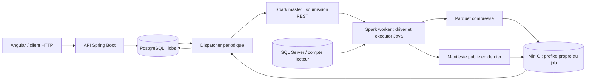

# Jobs persistants et execution Spark

Branche : `feature/storage-jobs`, base : `feature/minio-storage`.

## Parcours implemente



L'API conserve une demande avant de repondre HTTP 202 ; elle n'attend pas
l'extraction. Le dispatcher revendique un job en base, soumet le driver au
master Spark et conserve son identifiant. Il consulte ensuite le manifeste
MinIO et l'etat Spark. Aucune socket Docker n'est montee dans l'application.
Spring Batch n'est pas utilise dans ce parcours.

Spark, SQL Server, MinIO et PostgreSQL sont des services distincts. Les fichiers
Parquet ne sont pas stockes dans PostgreSQL. Cette base contient seulement
les demandes, dates, statuts, identifiants Spark, erreurs generiques et resultats.

## Demarrage

Ajouter les variables `POSTGRES_ADMIN_PASSWORD`, `JOBS_PASSWORD` et
`SPARK_UI_PORT` de `.env.example` a `.env`, avec deux secrets differents,
puis executer :

```powershell
docker compose up -d --build
docker compose ps -a
```

Les anciennes variables et les volumes SQL Server/MinIO sont conserves.
L'initialisation PostgreSQL ne s'execute qu'a la creation du volume ; changer
un mot de passe dans `.env` ne modifie pas celui d'un volume deja initialise.
Le role applicatif `atlas` n'est pas superutilisateur. Flyway applique le
schema de jobs via ce compte. PostgreSQL et les ports Spark RPC/REST restent
dans le reseau Docker ; seule l'interface Spark est exposee sur
[localhost:8088](http://localhost:8088), en boucle locale.

Spark 4.3.0 / Java 21 utilise l'image officielle `spark`. Le Dockerfile ajoute
le driver JDBC SQL Server et `hadoop-aws` 3.5.0, correspondant au Hadoop livre
dans cette distribution. Le JAR d'ingestion est compile dans Docker avec les
bibliotheques de cette meme image. Aucun SDK Java/Spark local n'est requis.

## API

### Creer une extraction

```powershell
$body = @{
  source_id = 'sqlserver'
  schema = 'dbo'
  table = 'Invoice'
  format = 'parquet'
  partition_by = @()
  fetch_size = 1000
  compression = 'snappy'
} | ConvertTo-Json
$job = Invoke-RestMethod -Method Post -Uri 'http://localhost:8000/storage/jobs' -ContentType 'application/json' -Body $body
$job
```

La reponse HTTP 202 contient `id`, `status`, la demande et les dates ; le header
`Location` indique `/storage/jobs/{id}`. La source et la table sont verifiees
avant la creation. Les identifiants SQL respectent ici le sous-ensemble
lettres/chiffres/underscore, sans espace ; aucun SQL libre n'est accepte.

Valeurs par defaut : schema `dbo`, format `parquet`, liste de partitions vide,
`fetch_size=1000`, compression `snappy`. La compression peut aussi etre
`uncompressed`. La taille de lecture JDBC est bornee entre 1 et 100 000.
Une liste de partitions non vide ou un format different est refuse avec 422
jusqu'a la fonctionnalite correspondante. La source persistante disponible
est `sqlserver` ; les connexions ponctuelles du formulaire ne sont pas stockees.

Chaque POST cree un nouveau job ; la relance et les cles d'idempotence de
requete ne font pas partie de cette version.

### Suivre et consulter

```powershell
Invoke-RestMethod "http://localhost:8000/storage/jobs/$($job.id)"
Invoke-RestMethod "http://localhost:8000/storage/jobs/$($job.id)/result"
Invoke-RestMethod 'http://localhost:8000/storage/jobs'
```

`GET /storage/jobs` renvoie les 100 demandes les plus recentes.
Un identifiant inconnu retourne 404. Le resultat retourne 409 tant que le job
n'est pas `COMPLETED`, y compris en cas d'echec. Le statut expose alors un
`error_code` generique, sans identifiants ni reponse brute JDBC/Spark.

## Etats et redemarrages

```text
QUEUED -> SUBMITTING -> RUNNING -> COMPLETED
              |            |
              +----------> FAILED
```

Le passage a `SUBMITTING` est atomique avec verrouillage de ligne. Un index
unique partiel limite a un seul job actif, y compris si deux dispatchers
tentent de revendiquer des jobs simultanement. Le reste attend dans PostgreSQL.

Les jobs en attente et l'historique survivent au redemarrage de l'API. Un job
`RUNNING` retrouve son identifiant Spark et continue d'etre surveille apres
redemarrage ; il n'est pas automatiquement soumis une seconde fois. Le master
Spark possede egalement un volume de recuperation locale. La haute disponibilite
multi-machines et la reprise d'un driver interrompu ne sont pas implementees.

Si la soumission est interrompue avant l'enregistrement de l'identifiant Spark,
le job est marque `SUBMISSION_UNCERTAIN` ; il peut deja exister cote Spark.
Une soumission en suspens est detectee apres 120 secondes. Il faut inspecter
Spark avant de creer une nouvelle extraction : cette version n'annonce pas
de garantie d'execution exactement une fois.

Une indisponibilite temporaire de Spark ou MinIO conserve le job actif. Le
delai total par defaut est de 1 800 secondes (`JOBS_TIMEOUT_SECONDS`) ; a
l'expiration, le dispatcher tente d'arreter le driver et marque l'echec.
Un resultat sans manifeste valide ne peut pas devenir `COMPLETED`.

## Fichiers et controles

```text
lake/sqlserver/dbo/Invoice/<job-id>/
  data/part-....snappy.parquet
  data/_SUCCESS
  manifest.json
```

Le driver transmet les identifiants JDBC dans les proprietes, jamais dans
l'URL ou les parametres publics du job. Les secrets sont fournis au worker
par environnement ; les comptes administrateurs SQL Server/MinIO/PostgreSQL
ne sont transmis ni au worker ni a l'API. Le masquage Spark couvre les noms
de proprietes contenant secret, password, token, access key ou credentials.

Spark lit la table par JDBC avec `fetchsize`, ecrit des fichiers de 100 000
lignes maximum, puis relit le Parquet pour compter les lignes effectivement
ecrites. Il n'y a ni `collect()` ni chargement de toute la table dans le driver.
Les types sont ceux du lecteur JDBC Spark ; les tests verifient notamment
les montants `DECIMAL(12,2)` et les dates de factures.

Le manifeste est publie apres le commit des fichiers et inclut nombre de
lignes, nombre de fichiers, octets Parquet, schema, compression et identifiant
de l'application Spark. Les octets mesures concernent les fichiers Parquet,
pas le manifeste et les fichiers de controle. L'API exige aussi `_SUCCESS`.

Les prefixes sont propres a chaque UUID et ne sont pas ecrases. Les fichiers
partiels d'un job en erreur peuvent rester dans son prefixe ; ils ne doivent
pas etre enregistres au futur catalogue comme un resultat valide.

## Limites de cette premiere version

- Un job actif, un worker de deux coeurs (un pour le driver et un pour
  l'executor), driver et executor de 512 Mio chacun.
- Une partition JDBC : le traitement est execute par Spark, mais la lecture
  repartie de la source reste a ajouter. `fetch_size` n'est pas un nombre de
  partitions et ne definit pas non plus la taille d'un fichier Parquet.
- Extraction complete de la table ; selection de colonnes/filtres et chargement
  incremental restent a developper.
- Pas de snapshot commun garanti si la table change pendant l'extraction.
- Pas encore de partitionnement de stockage, catalogue, Trino ou ecran Angular
  de suivi. Les endpoints sont utilisables dans `/docs` ou par client HTTP.
- Les modeles Kubernetes anterieurs n'activent pas encore les jobs. Le reseau,
  les identites et les secrets Spark cloud demandent une configuration dediee.

## Tests

```powershell
docker compose --profile tools run --rm backend-tests
```

`RUN_JOB_TESTS=true` ajoute les tests PostgreSQL et Spark. Les tests utilisent
`atlas_test`, sans toucher a l'historique applicatif `atlas`, et le dispatcher
du contexte de test est desactive. Le test Spark pilote lui-meme son execution,
extrait les 5 000 factures, verifie les compteurs, types et signatures Parquet,
puis supprime uniquement les objets de ses prefixes UUID. Les tests couvrent
aussi validation API, concurrence des revendications, persistance et erreurs.

Validation effectuee sur cette branche : 40 tests backend reussis, sans test
ignore. Un lancement par l'API Angular `/api/storage/jobs` a aussi ete verifie
avec redemarrage du backend pendant l'execution : le suivi a retrouve le job,
termine avec 5 000 lignes et un fichier Parquet de 55 712 octets. Cette mesure
est un controle fonctionnel sur les donnees de demonstration, pas un benchmark.

References : [Spark standalone et REST](https://spark.apache.org/docs/4.3.0/spark-standalone.html),
[JDBC Spark](https://spark.apache.org/docs/4.3.0/sql-data-sources-jdbc.html),
[Parquet Spark](https://spark.apache.org/docs/4.3.0/sql-data-sources-parquet.html),
[initialisation PostgreSQL Docker](https://hub.docker.com/_/postgres).
