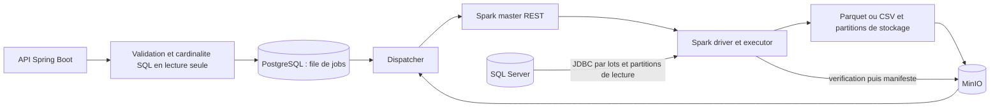

# Jobs persistants, formats et partitionnement

Branche : `feature/partitioning-csv`, base : `feature/large-dataset`.
Les deux branches precedentes restent des dependances explicites ; pas de fusion automatique.

## Flux



Spring Boot conserve la demande et repond HTTP 202 sans attendre l'extraction.
Spark execute le traitement ; Spring Batch n'est pas utilise. PostgreSQL stocke
les demandes, etats et resultats, jamais les donnees extraites. Aucune socket
Docker n'est montee dans l'application.

## Installation et mise a jour

Configurer `.env` depuis `.env.example`, sans changer les secrets deja enregistres
dans les volumes. Puis executer dans PowerShell :

```powershell
docker compose up -d --build
docker compose ps -a
```

Reconstruire **aussi Spark** lors d'une mise a jour : le protocole d'arguments
du driver evolue avec l'API. Laisser les anciens jobs actifs terminer avant de
remplacer master/worker. Les demandes JSON conservees sans les nouveaux champs
restent lisibles grace aux valeurs par defaut. Aucun nouveau volume ni reseed
n'est necessaire pour cette fonctionnalite.

Le worker possede deux coeurs : un pour le driver, un pour l'executor, chacun
avec 512 Mio. Les 4 lecteurs JDBC par defaut sont des taches qui se succedent
sur cet executor ; 16 partitions de lecture ne demandent pas 16 coeurs disponibles.
Spark 4.3.0 / Java 21 embarque Hadoop 3.5.0 ; le connecteur S3A correspond a ce
Hadoop. Tous les builds et tests passent par Docker.

## Creer et suivre une extraction

L'exemple exact du sujet fonctionne, avec un partitionnement mensuel par defaut :

```json
{"source_id":"sqlserver","table":"Invoice","format":"parquet","partition_by":["invoice_date"]}
```

Exemple complet en PowerShell :

```powershell
$body = @{
  source_id = 'sqlserver'
  schema = 'dbo'
  table = 'Invoice'
  format = 'csv'
  compression = 'gzip'
  partition_by = @('invoice_date')
  partition_granularity = 'month'
  fetch_size = 1000
  num_partitions = 4
} | ConvertTo-Json
$job = Invoke-RestMethod -Method Post -Uri 'http://localhost:8000/storage/jobs' -ContentType 'application/json' -Body $body
Invoke-RestMethod "http://localhost:8000/storage/jobs/$($job.id)"
Invoke-RestMethod "http://localhost:8000/storage/jobs/$($job.id)/result"
```

`GET /storage/jobs` retourne les 100 derniers jobs. `Location` dans la reponse
202 indique l'URL du suivi (prefixe `/api` et port public conserves via Nginx). Le resultat
retourne 409 avant COMPLETED ; identifiant inconnu : 404. Un POST cree toujours
un nouvel UUID. Source persistante disponible : `sqlserver`. Les connexions
ponctuelles de l'explorateur ne sont pas sauvegardees comme sources de jobs.

| Parametre | Valeurs | Defaut |
| --- | --- | --- |
| schema | Identifiant SQL simple, nom exact | dbo |
| format | parquet, csv | parquet |
| compression Parquet | snappy, zstd, uncompressed | snappy |
| compression CSV | gzip, uncompressed | gzip |
| partition_by | 0 a 8 noms de colonnes exacts, sans doublon | [] |
| partition_granularity | month, year, day | month |
| fetch_size | 1 a 100000 | 1000 |
| num_partitions | 1 a 16 | 4 |

Une combinaison invalide, par exemple CSV/snappy, retourne 422 avec une
explication dans `errors.compression`. Les valeurs soumises et secrets ne sont
pas recopies dans les erreurs de validation.

## Partitions de stockage

Une colonne date/timestamp derive des colonnes entieres, placees a la fin du
schema du manifeste. La date d'origine reste dans chaque fichier de donnees.

| Granularite | Colonnes derivees | Exemple de chemin |
| --- | --- | --- |
| year | invoice_date_year | invoice_date_year=2025/ |
| month | invoice_date_year, invoice_date_month | invoice_date_year=2025/invoice_date_month=3/ |
| day | invoice_date_year, invoice_date_month, invoice_date_day | invoice_date_year=2025/invoice_date_month=3/invoice_date_day=15/ |

`month` evite la multiplication des petits fichiers. `day` est un choix explicite
pour les comparaisons futures. Les colonnes non date, par exemple `status`,
`city` et `payment_method`, sont partitionnees directement. Spark encode les
caracteres speciaux des valeurs dans les chemins Hive ; les NULL utilisent son
repertoire special `__HIVE_DEFAULT_PARTITION__`.

Avant de creer le job, l'API verifie la structure puis effectue un
`COUNT_BIG(DISTINCT colonne)` via le compte lecteur. Colonne inconnue, cle
primaire (y compris membre d'une cle composee), plus de 1000 valeurs distinctes,
type non compatible ou conflit de nom derive : 422, aucun job persiste.
La limite s'applique **a la colonne source, dates comprises**, conformement au
prompt : une date couvrant plus de 1000 jours distincts est refusee meme avec
une granularite annuelle. Les dates du seed couvrent 730 jours / 24 mois.
Les NULL ne comptent pas dans COUNT DISTINCT et peuvent ajouter un repertoire.
La combinaison de plusieurs colonnes peut multiplier les repertoires : preferer
une seule colonne pertinente. Les controles ne constituent pas un snapshot ;
une modification concurrente de la source peut changer sa cardinalite.

## Trois tailles differentes

| Reglage | Effet |
| --- | --- |
| fetch_size | Lignes demandees par aller-retour reseau JDBC ; n'impose pas un nombre de fichiers |
| num_partitions | Nombre demande de lecteurs/taches JDBC, avec leurs connexions ; independant des repertoires Hive |
| maxRecordsPerFile | Limite fixe de 100000 lignes par fichier de sortie ; independante des lots reseau |

Avec plusieurs lecteurs, Spark utilise la **cle primaire entiere unique** et
ses bornes MIN/MAX. Les bornes calculent les intervalles de lecture, elles ne
filtrent pas les lignes. Sans cle primaire entiere a une colonne, ou sur une
plage vide/constante, lecture avec une seule partition et raison explicite dans
`parallel_read_note`. Spark peut reduire le nombre effectif de partitions pour
une petite plage. `effective_num_partitions` rapporte la valeur reelle.
Plusieurs lecteurs peuvent produire plusieurs fichiers dans chaque repertoire.
Il n'y a pas de snapshot SQL partage entre les lecteurs.

## Contrat CSV pour le futur catalogue Hive/Trino

Le CSV utilise le futur format Hive **TEXTFILE type**, sans en-tete, virgule,
UTF-8, NULL `\N`, dates `yyyy-MM-dd`, timestamps `yyyy-MM-dd HH:mm:ss` en UTC,
decimaux en notation simple avec echelle conservee. Les options sont consignees
dans `csv_options`. Les colonnes de partition sont dans le chemin, pas dans le
contenu des fichiers ; les colonnes date d'origine restent dans le contenu.

TEXTFILE avec un simple separateur ne gere pas les champs CSV entre guillemets.
L'ecriture est donc sans quoting/escaping. Une chaine contenant virgule,
retour ligne, retour chariot, NUL ou la valeur litterale `\N` provoque l'echec
Spark (pas de manifeste de succes) ; choisir Parquet pour ces donnees. Les
verifications sont appliquees par UDF dans le flux d'ecriture, sans collecter
les lignes ni executer une seconde extraction. Les timestamps sont tronques
au format demande a la seconde ; les fractions ne sont pas conservees en CSV.
Gzip est pris en charge, avec son compromis CPU et l'absence de decoupage d'un
meme fichier compresse entre plusieurs lecteurs SQL.

## Fichiers, manifeste et durees

```text
lake/sqlserver/dbo/Invoice/<uuid>/
  data/invoice_date_year=2025/invoice_date_month=3/part-....csv.gz
  data/_SUCCESS
  manifest.json
```

Chaque UUID garde son prefixe ; aucun ecrasement. Spark relit la sortie (schema
explicite pour CSV) et compte les lignes, sans seconde extraction JDBC.
Le manifeste v2 contient le schema type `schema_json`, `partition_columns`
(nom, type Spark, colonne source, indicateur derive), les formats et compteurs :

| Champ | Definition |
| --- | --- |
| extract_write_ms | Plan JDBC, MIN/MAX et lecture + transformations + commit des fichiers |
| verify_ms | Relecture de la sortie, comptage, inventaire des fichiers et controle _SUCCESS |
| spark_duration_ms | Debut du main jusqu'a la fin de verification, avant publication du manifeste ; inclut initialisation Spark, exclut attente en file et arret de session |
| row_count | Lignes comptees dans les fichiers ecrits |
| file_count | Fichiers de donnees uniquement |
| storage_bytes | Somme des octets de ces fichiers, hors manifeste et marqueurs |
| partition_file_counts | Nombre de fichiers par chemin de partition ; __unpartitioned__ sans repertoire Hive |

Le manifeste est publie en dernier. Le dispatcher exige UUID, prefixe, format,
compteurs valides et `_SUCCESS`, puis enrichit le resultat avec bucket et
manifest_key. Les champs ci-dessus sont accessibles via GET resultat. Les
secrets JDBC/MinIO ne font partie ni des arguments Spark REST ni du manifeste.
Les comptes administrateurs servent seulement aux services d'initialisation.

## Etats et limites

```text
QUEUED -> SUBMITTING -> RUNNING -> REGISTERING -> COMPLETED
              |            |           |
              +------------+-----------+----> FAILED
```

Un index PostgreSQL limite a un seul job actif ; les autres attendent. Les
revendications sont atomiques. Historique et jobs en attente survivent a un
redemarrage. Le dispatcher retrouve les drivers RUNNING apres redemarrage,
sans resoumission automatique. Une soumission interrompue devient FAILED avec
`error_code=SUBMISSION_UNCERTAIN` ; inspecter Spark avant une nouvelle demande.
Ce n'est pas un statut autonome. SUBMITTING expire apres 120 secondes ; delai
Spark par defaut 1800 secondes. REGISTERING utilise des requetes SQL bornees
a 60 secondes et peut attendre le retour du catalogue pour retirer ses
metadonnees avant FAILED. Les indisponibilites temporaires Spark/MinIO
ne font pas perdre le suivi tant que ce delai n'est pas depasse.

Des fichiers partiels peuvent rester apres un echec ; sans manifeste valide ils
ne sont jamais exposes comme resultat termine. Pas de relance automatique,
de selection de colonnes/filtres ni de chargement incremental. La branche feature/hive-catalog-trino ajoute le catalogue et les API SQL ;
les ecrans Angular de suivi restent a venir. Les nouveaux jobs deviennent
COMPLETED apres verification SQL ; les anciens resultats ne sont pas migres
automatiquement. Voir [catalogue et Trino](catalog-trino.md).
Les modeles Kubernetes n'activent pas encore ces jobs.

## Verification Docker

```powershell
docker compose --profile tools run --rm backend-tests
```

Les tests utilisent BusinessDB small et la base isolee `atlas_test`, dispatcher
applicatif desactive. Ils couvrent la validation, cardinalite reelle SQL Server,
concurrence, persistance et erreurs, puis lancent de vrais jobs Spark : Parquet
non partitionne, Parquet/zstd mensuel et CSV mensuel gzip/sans compression.
Ils verifient 5000 lignes, 24 repertoires, types et dates, notation decimale,
quatre partitions JDBC, tailles des objets, compteurs et durees. Seuls les objets
des UUID des tests sont supprimes.

Validation du 19 novembre 2026 : 47 tests backend passes sans test ignore,
7 tests Angular passes, images API/Spark/frontend construites dans Docker.
Le controle du proxy a revele la perte du port public dans Location ; Nginx
transmet maintenant le Host complet et le test de regression exige :3000/api.
Un job lance via /api avec l'exemple exact du sujet a termine avec 5000 lignes,
24 repertoires, 96 fichiers Parquet/snappy et 331451 octets de donnees.
Manifeste : extract_write_ms=48529, verify_ms=21227, spark_duration_ms=77646,
4 lecteurs JDBC. Il s'agit d'un controle fonctionnel unique sur small, pas d'un
benchmark ; les mesures comparables et repetees appartiennent a la suite.

Le contrat CSV est egalement verifie avec des valeurs qui ne figurent pas dans
le seed : espaces en debut/fin de chaine (conserves explicitement), guillemets,
NULL, petit decimal sans exposant, date et timestamp ; virgules, retours ligne
et marqueur NULL litteral doivent echouer. Le manifeste indique
`csv_preserve_whitespace=true`. Lancer ce controle dans l'image Spark courante :

```powershell
docker compose run --rm --no-deps --entrypoint /bin/bash --volume "${PWD}/spark/tests:/checks:ro" spark-master /checks/verify-csv.sh
```

Ce controle ne contacte ni SQL Server ni MinIO. Il a retourne
`CSV_CONTRACT_PASSED`. Le parcours via Nginx a aussi verifie CSV sans compression
partitionne directement par status : 5000 lignes, 3 repertoires, un lecteur.
